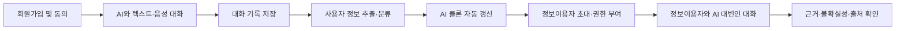

# EVERME

> 일상의 대화로 나를 기록하고, 기록을 바탕으로 나를 이해하는 AI 클론 서비스

## 프로젝트 소개

**EVERME(에버미)**는 사용자와 AI가 나눈 일상적인 대화를 축적·분석하여 개인의 경험, 선호, 가치관, 행동 패턴 등을 기록하고, 이를 바탕으로 **AI 클론(대변인)**을 제공하는 웹 서비스입니다.

사용자는 텍스트 또는 실시간 음성으로 AI와 자연스럽게 대화할 수 있습니다. 시스템은 대화에서 유의미한 정보를 추출하고 출처와 시점을 연결하여 관리합니다. 사용자가 접근 권한을 부여한 **정보이용자**는 AI 클론에게 질문하고, 기록에 근거한 답변과 예상 의사를 확인할 수 있습니다.

AI 클론은 실제 사용자를 대체하거나 법적 의사결정을 대신하는 존재가 아닙니다. 기록된 사실과 AI의 추론을 구분하고, 판단 근거 및 불확실성을 함께 제시하는 것을 지향합니다.

## 기획 배경

사람의 경험과 생각, 취향, 의사결정 방식은 일상 속 대화에 드러나지만 대부분 체계적으로 남지 않습니다. 특히 본인이 직접 의사를 표현하기 어려운 상황에서는 주변 사람이 과거의 선택과 가치관을 충분히 이해하기 어렵습니다.

EVERME는 별도의 기록 작업을 강요하기보다 **일상적인 대화 자체를 기록의 출발점**으로 삼습니다. 초기에는 독거노인의 대화 및 의사표현 지원이라는 문제의식에서 출발했으며, 현재는 다양한 사용자가 자신의 이야기를 축적하고 허용된 상대와 공유할 수 있는 범용 서비스로 확장하여 기획하고 있습니다.

## 주요 사용자

| 역할 | 설명 |
| --- | --- |
| 사용자 | AI와 대화하며 자신의 정보를 축적하고 AI 클론 및 접근 권한을 관리하는 사람 |
| 정보이용자 | 사용자로부터 권한을 부여받아 해당 AI 클론과 대화하는 사람 |

하나의 계정에서 두 역할을 이용할 수 있으며, **로그인 후 사이드바에서 이용 모드를 전환**합니다.

## 핵심 기능

### 1. AI 대화

- 텍스트 및 실시간 음성(STT/TTS) 대화
- 하나의 대화 화면에서 텍스트·음성 방식 전환
- 스트리밍 응답, 대화 맥락 유지 및 개인화 대화
- 능동적 후속 질문과 대화 주제 추천
- 세션별 대화 기록 조회 및 관리
- 음성 인식 오류 등 사용자 발언 정정

### 2. 사용자 데이터 축적 및 분석

- 대화에서 사실, 경험·기억, 가치관, 선호, 행동 패턴 등의 정보 추출
- 정보 유형 분류와 원본 대화 출처 연결
- 중복·상충 정보 및 시간에 따른 변화 관리
- 대화 원문과 분석 정보를 활용한 검색 기반 지식 구성

### 3. AI 클론 및 대변인

- 축적된 사용자 정보를 기반으로 AI 클론 자동 생성 및 갱신
- 사용자의 의사표현 가능 여부와 무관하게 클론 상시 활성화
- 정보이용자의 질문에 대한 기록 기반 응답 및 예상 의사 추론
- **기록된 사실 / AI 추론 / 판단 근거 / 불확실성 / 출처** 구분
- 충분한 근거가 없는 경우의 불확실성 안내

### 4. 정보이용자 및 접근 권한

- 정보이용자 초대, 수락·거절, 권한 변경 및 철회
- 정보별 민감도 등급 **L1(일반) ~ L4(최고민감)** 분류
- 정보이용자별 최대 접근 등급 설정
- 그룹별 정보이용자 관리 및 일괄 권한 설정 *(세부 정책 검토 중)*
- 권한에 따른 검색·응답 필터링 및 접근 이력 조회

### 5. 계정 및 개인정보

- 회원가입, 로그인, 비밀번호 재설정, 프로필 관리
- 개인정보 수집 및 AI 활용 동의 관리
- 계정 탈퇴 및 개인정보 처리 정책 적용

## 서비스 이용 흐름

## AI 응답 처리 개념

EVERME는 사용자별 기록을 바탕으로 답변을 생성하기 위해 **RAG(Retrieval-Augmented Generation)**와 **Tool Calling**을 활용하는 구조를 지향합니다.

1. 대화 기록과 추출된 사용자 정보를 저장합니다.
2. 추출 정보의 민감도를 L1~L4로 분류하고, 유효한 등급이 없는 분석 정보는 저장 대상에서 제외합니다.
3. 정보이용자의 인증 및 접근 권한을 서버에서 검증합니다.
4. 허용된 범위의 기록을 RAG로 검색하고, 필요한 구조화 정보·통계·변경 이력은 Tool Calling으로 조회합니다.
5. 검색·조회 결과를 근거로 답변을 생성합니다.
6. 응답에서 비인가 정보의 직접·간접 노출 여부를 재검증합니다.
7. 최종 답변에 사실과 추론의 구분, 판단 근거, 불확실성 및 접근 가능한 출처를 표시합니다.

**파인튜닝을 통한 개인별 모델 학습이 아니라, 축적된 기록을 검색·활용하는 방식**을 기본 방향으로 합니다.

## 기술 스택 (계획)

| 구분 | 기술 |
| --- | --- |
| Frontend | React, Next.js |
| Backend | Java, Spring Boot |
| AI | Spring AI, LLM, RAG, Tool Calling |
| Voice | STT, TTS |
| Database | PostgreSQL, 벡터 검색 저장소(구체적 구성 검토) |
| Data Access | MyBatis |
| Design | Penpot |

세부 라이브러리, 모델 제공자, 배포 인프라 및 버전은 구현 과정에서 확정합니다.

## UI/UX 설계 방향

- **PC 우선 설계** 후 반응형 웹으로 확장
- 화이트 기반 라이트 테마와 녹색 포인트 컬러
- 대화 중심의 단순하고 직관적인 화면 구성
- 사이드바에서 사용자/정보이용자 모드 전환
- AI 대화와 대화 기록을 하나의 화면으로 통합
- 정보이용자와 그룹 관리를 하나의 관리 화면에서 제공
- 응답 근거는 필요할 때 확인할 수 있는 상세 패널로 제공
- 다양한 연령대의 사용자를 고려한 가독성과 접근성

## 보안 및 신뢰성 원칙

- 사용자별 데이터의 논리적 격리와 서버 측 인증·인가
- HTTPS/WSS 기반 통신 암호화
- 민감정보 저장 시 암호화 및 접근 등급 검증
- RAG 검색 단계와 최종 응답 단계의 이중 권한 필터링
- 중요 접근 및 권한 관련 행위의 감사 기록
- 프롬프트 인젝션과 비인가 정보 유출 방지
- AI 클론임을 명확히 고지하고 실제 사용자의 법적 의사나 동의를 대체하지 않음

## 프로젝트 진행 상태

**현재 단계: 요구사항 분석 및 UI/UX 설계**

- [x] 서비스 주제 및 핵심 사용자 역할 정의
- [x] 주요 기능 및 비기능 요구사항 정리
- [x] PC UI/UX 구조 및 디자인 방향 수립
- [ ] 상세 화면 설계 및 디자인 시스템 확정
- [ ] 데이터 모델 및 시스템 아키텍처 확정
- [ ] API 설계
- [ ] Frontend / Backend 구현
- [ ] AI 대화·RAG·Tool Calling 연동
- [ ] STT/TTS 연동
- [ ] 권한·보안·통합 테스트
- [ ] 배포 및 운영 검증

> 이 문서는 **개발 착수 전 프로젝트 소개 문서**입니다. 실제 구현 내용, 기술 스택 및 기능 범위는 개발 진행에 따라 갱신됩니다.
