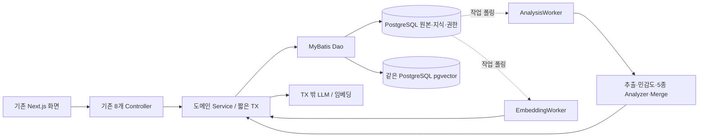
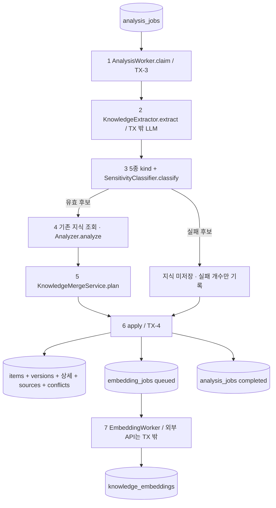

# EVERME 백엔드 상세 아키텍처

기준일: 2026-11-26. 사용자 첨부 변경 명세를 기준으로 기존 구조를 확장한다. Spring Boot 3.5.8, Java 21, Spring MVC, MyBatis, PostgreSQL + pgvector 설계다. pgvector는 아직 실제 DB 확장·모델·차원 설치를 확인하지 않은 설계 대상이다. 운영 DB나 애플리케이션 기능을 구현한 문서가 아니다.

## 적용 범위와 문서 기준

- 기존 Controller → Service → Dao, 8개 HTTP 도메인과 실행 코드 57개 경로를 유지한다. 남은 컨트롤러의 `return null;` 골격은 유지하고 약관 조회 삭제를 테스트에 반영한다.
- 설계 API는 기존 목록 GET에 `kind`를 추가하고 summary GET 한 개를 더해 58개다. kind 5개 값은 같은 경로의 필터이며 API 5개 추가가 아니다. 현재 코드에 kind 바인딩과 summary가 아직 없다는 차이를 명시한다.
- DBML 기준 파일: [everme.dbml](everme.dbml). `docs/database/everme.dbml`, `output/architecture/everme-rag-proposal.dbml`은 동일 내용 사본이다. 원본에서 약관 2개 제거 후 20 + 기존 벡터 제안 2 = 22, 상세 5 추가 = 핵심 27, 그룹 API의 저장 누락을 보완하는 `member_groups` 1 추가 = 전체 28개다. 약관 문서와 동의 이력 테이블 2개는 최신 요청에 따라 제거했다.
- 설계 무결성 보완 SQL: [constraints-design.sql](constraints-design.sql). DBML의 PK/FK/UNIQUE/CHECK를 보완하는 트리거 설계이며 자동 실행 migration이 아니다.
- [API_ENDPOINTS.md](../API_ENDPOINTS.md)는 현재/목표 계약을 구분한다. [ANALYSIS_API.md](ANALYSIS_API.md)는 조회 계약 상세다. `architecture-model.json`과 기존 HTML은 DBML에서 재생성한 테이블·FK 및 본 문서의 호출 계약을 사용한다.
- `docs/`, `output/`은 기존 gitignore 대상이므로 추적 가능한 기준 설계는 `backend/design/`에 둔다. .gitignore를 임의로 변경하거나 commit/push하지 않는다.

## 전체 시스템 경계



대화 세션·메시지는 공통 테이블을 유지하고 HTTP/업무 책임만 owner/viewer로 분리한다. 사용자 메시지 응답과 장기 기억 구축은 독립적으로 진행한다. 공개 분석 실행·임베딩 재시도·직접 지식 편집 API는 추가하지 않는다. Work Queue는 우선 DB 폴링이며 Kafka 등은 필수가 아니다.

## 패키지·클래스 책임과 메서드 계약

아래는 **구현 예정 설계**다. 현재 없는 Java 클래스나 메서드를 이번 작업에서 생성하지 않는다. 기존 동일 역할은 재사용한다. Dao는 XxxDao, 도메인 서비스는 XxxService 네이밍을 유지한다. KnowledgeExtractor/Analyzer/Classifier와 Worker는 업무 서비스가 아닌 전략·처리자 이름이다.

| 패키지/클래스 | 상태 | 주요 메서드 설계 | 의존관계·책임 |
| --- | --- | --- | --- |
| controller.AnalysisController | 기존 | analysis(kind,page,size), analysisDetail(informationId), summary() | AnalysisService 호출. 입력 바인딩·응답 매핑만. kind/summary는 후속 코드 반영 대상 |
| service.AnalysisService | 기존 빈 클래스 | list(ownerId,kind,page,size), get(ownerId,itemId), summarize(ownerId) | AnalysisDao/KnowledgeDao. owner는 인증 주체에서 결정. 현재/과거·충돌을 구분해 조회 |
| service.OwnerConversationService | 기존 빈 클래스 | send(ownerId,sessionId,content), saveUserTurn(), saveAssistantTurn() | TX-1 원문·작업 / TX 밖 응답 생성 / TX-2 답변 저장. 분석 완료를 기다리지 않음 |
| service.ViewerConversationService | 기존 빈 클래스 | answer(consumerId,sessionId,question), evidence(...) | 권한 → RagService → 응답 검증 → 답변·근거 저장 |
| service.analysis.KnowledgeExtractor | 신규 설계 | extract(SourceContext): List<AtomicKnowledge> | LLM 호출. 최근 사용자 문맥을 포함하고 명시적 사용자 원문만 출처로 삼음 |
| service.analysis.KnowledgeAnalyzer | 신규 인터페이스 설계 | supports(KnowledgeKind), analyze(candidate,existing): AnalysisDecision | 5종 구현을 kind로 선택. 검증·정규화·변경 판정 제안 |
| service.analysis.FactAnalyzer | 신규 설계 | analyze(...) | 주체/술어/값 형식 정규화. 사실 반복을 확신 가중치로 사용하지 않음 |
| service.analysis.MemoryAnalyzer | 신규 설계 | analyze(...) | 사건·장소·인물·시점 정밀도. 사건끼리 잘못 합치지 않음 |
| service.analysis.ValueAnalyzer | 신규 설계 | analyze(...) | 판단 영역·원칙·조건·우선도. 발언 없는 신념을 단정하지 않음 |
| service.analysis.PreferenceAnalyzer | 신규 설계 | analyze(...) | 대상·호불호·조건·강도. 조건이 다른 선호를 곧바로 충돌로 보지 않음 |
| service.analysis.BehaviorAnalyzer | 신규 설계 | analyze(...) | 행동·발생 계기·빈도·습관성. 단일 발언으로 습관을 확정하지 않음 |
| service.analysis.SensitivityClassifier | 신규 설계 | classify(candidate): SensitivityResult | 원자 정보별 L1~L4 검증. 실패 후보를 저장하지 않음 |
| service.analysis.KnowledgeMergeService | 신규 설계 | plan(candidate,existing), apply(jobId,leaseToken,plans) | 최종 NEW/DUPLICATE/TEMPORAL_CHANGE/CONFLICT/CLASSIFICATION_FAILED 판정. apply만 TX-4 |
| service.worker.AnalysisWorker | 신규 설계 | poll(), claim(), process(), heartbeat() | AnalysisDao로 TX-3 점유 → TX 밖 추출·분석 → MergeService.apply. 긴 TX 없음 |
| service.worker.EmbeddingWorker | 신규 설계 | poll(), claim(), embed(), complete() | embedding_jobs 점유 → TX 밖 임베딩 → 저장 TX. lease/token/fingerprint 재검증 |
| service.rag.RagService | 신규 설계 | retrieve(accessContext,question): EvidenceContext | KnowledgeDao 후보 검색·분류 상세 조회·2차 권한 검사. 벡터 검색 자체를 Tool Calling으로 우회하지 않음 |
| service.rag.AccessPolicyService | 신규 설계 | resolve(consumerId,cloneId), revalidate(...) | 기존 AccessService를 기반으로 정책 분리하는 협력자. 새 권한의 원본 테이블을 중복 생성하지 않음 |
| service.rag.ToolQueryService | 신규 설계 | executeAllowed(tool,accessContext,args) | 필요한 경우에만 유형별 통계·정확한 날짜/속성 SQL 질의. 모델 지정 owner/등급은 무시 |
| dao.AnalysisDao | 기존 빈 클래스 | listByOwner(), summaryByKind(), claimAnalysisJob(), extendLease() | MyBatis 조회·원자 점유 SQL. LLM 호출 없음 |
| dao.KnowledgeDao | 신규 설계 | searchCandidates(), loadVersionWithDetail(), findSources(), insertVersionAndDetail(), upsertEmbedding() | 지식·상세·출처·벡터 SQL. 업무 판단·트랜잭션 경계는 Service |
| dto 설계 | 후속 추가 | KnowledgeKind, AnalysisQuery, AnalysisListResponse, AnalysisDetailResponse, AnalysisSummaryResponse, AtomicKnowledge, AnalysisDecision | KnowledgeKind는 FACT/MEMORY/VALUE/PREFERENCE/BEHAVIOR 5종. DTO는 DB 엔티티나 LLM 원문 JSON을 그대로 반환하지 않음 |

서비스의 같은 인스턴스 내부 호출로 `@Transactional`이 적용된다고 가정하지 않는다. TX-1/2/3/4와 임베딩 점유/저장은 별도 Spring 빈 또는 TransactionTemplate 경계로 구현할 예정이다. 외부 API 구간에는 Connection/행 잠금을 보유하지 않는다.

## 5대 지식과 이력 모델

| kind | 상세 테이블 | 실제로 활용하는 고유 속성 |
| --- | --- | --- |
| FACT | fact_details | subject_scope, predicate_code, value_type, value_ciphertext, unit_code |
| MEMORY | memory_details | event_type, location_ciphertext, participants_ciphertext, emotional_tone, recall_precision |
| VALUE | value_details | domain_code, principle_ciphertext, priority_band, scope_ciphertext |
| PREFERENCE | preference_details | target_type, target_ciphertext, polarity, strength, context_ciphertext |
| BEHAVIOR | behavior_details | action_code, trigger_ciphertext, frequency_unit, frequency_count, automaticity |

상세는 `version_id` PK로 knowledge_versions의 특정 버전에 연결된다. item_id에 연결하면 새로운 분석으로 과거 상세가 덮어써지므로 채택하지 않는다. 소유자·내용·시점·등급·활성·암호화 키는 공통 테이블을 JOIN하며 상세에 복사하지 않는다. 상세의 kind는 내용 속성 중복이 아니라 서로 다른 상세가 같은 버전에 붙는 것을 차단하는 **고정 타입 가드**다.

`knowledge_items(id,kind)` UNIQUE → `knowledge_versions(item_id,kind)` 복합 FK, `knowledge_versions(id,kind)` UNIQUE → 각 상세 `(version_id,kind)` 복합 FK. 상세별 kind 상수 CHECK와 version_id PK로 같은 버전에 다른 분류/두 행을 연결할 수 없다. 누락까지 방지하려면 커밋 시점 지연 제약 트리거가 필요하다. 일반 CHECK에서 다른 테이블의 행을 조회하는 설계는 채택하지 않는다. [PostgreSQL 제약 문서](https://www.postgresql.org/docs/current/ddl-constraints.html)

JSON 덩어리 대신 개별 코드·극성·수치·빈도를 모델링했다. 민감한 실제 값은 개별 ciphertext 칼럼에 저장하고 공통 encryption_key_id를 사용한다. 코드·강도·빈도도 접근 통제 대상이다. 민감한 속성 코드가 평문 검색 인덱스에 나타나는 위험을 고려해 저장장치/백업 암호화와 DB 권한을 적용해야 한다. L4 값에 대한 키 관리·복호화 범위는 구현 전 보안 설계가 필요하다. 암호화한 실제 값의 범위 검색은 이 설계로 지원한다고 주장하지 않는다.

기존 7종의 소문자 kind에서 5종 대문자로 바뀐다. fact/memory/value/preference/behavior는 1:1 매핑 가능하나 personality/linguistic_style은 자동 VALUE/BEHAVIOR로 변환하지 않는다. 원문·기존 버전을 보존하고 읽기 전용 legacy 백업 또는 전환 staging에서 근거 기반 재분류 후 새 구조에 적재한다. 이번 작업은 운영 migration을 실행하지 않는다.

## 동기 사용자 대화: TX-1 / 외부 응답 / TX-2

| 순번 | 호출 | TX | 읽기/쓰기 |
| --- | --- | --- | --- |
| 1 | OwnerConversationController.send → OwnerConversationService.send | 밖 | 인증 owner, 세션 personal/소유권 검사 |
| 2 | OwnerConversationService.saveUserTurn → Dao | TX-1 | messages user INSERT, message_revisions INSERT, analysis_jobs queued INSERT. 한 트랜잭션 |
| 3 | RagService.retrieve + 최근 세션 맥락 조회 | 밖 | 세션 최근 발언·기존 지식 검색. 분석이 아직 안 끝나도 계속 진행 |
| 4 | LLM 응답 생성 | 밖 | 외부 네트워크 호출. 신규 메시지 자체는 최근 맥락에 포함 |
| 5 | OwnerConversationService.saveAssistantTurn | TX-2 | messages assistant INSERT/상태 갱신, message_revisions INSERT. analysis_jobs 미생성 |
| 6 | Controller 응답 | 밖 | messageId, 답변과 생성 상태. 외부 LLM 실패 시 원문은 남기고 실패 상태 제공하는 계약은 후속 구현 |

분석이 실패해도 원래 AI 대화 응답을 취소하지 않는다. 반대로 LLM 응답 실패도 이미 커밋한 사용자 원문·분석 작업을 롤백하지 않는다. 클라이언트 중복 전송 idempotency-key 계약은 기존 범위에 없어 구현 전 별도 확정한다.

## 비동기 ETL: 점유와 분석의 분리



TX-3는 `queued` 또는 기한이 지난 `running` 작업을 순서 있게 `FOR UPDATE SKIP LOCKED`로 가져와 status, 새로운 lease_token, lease_until, locked_by, attempt_count를 갱신하고 즉시 커밋한다. `SKIP LOCKED`는 큐 소비자 경합 회피 용도이며 일반 조회의 일관된 스냅샷을 제공하는 기능은 아니다. [PostgreSQL SELECT 문서](https://www.postgresql.org/docs/current/sql-select.html)

점유 후 외부 호출은 TX 밖이다. heartbeat는 `id + running + lease_token + 아직 유효한 lease` 조건으로만 기한을 연장한다. 과거 워커가 새 토큰을 덮어쓰거나 만료 lease를 되살리지 못하게 한다. heartbeat 실패 시 결과를 버린다. 기본 max_attempts=3은 조정 가능한 설계 가정이다.

TX-4 잠금 순서: owner의 accounts 행 → 해당 analysis_jobs 행 → 지식 항목/버전. 현재 token·lease·running·원문/세션 활성 여부를 확인하고 기존 지식을 다시 읽는다. 같은 소유자의 신규 지식이 동시에 같은 의미로 저장되지 않도록 최종 병합을 owner 범위에서 직렬화한다. LLM에서 나온 계획이 현재 상태와 달라졌다면 순수 결정 로직으로 재검증하며, 불확실한 신규/중복은 강제 덮어쓰기 대신 충돌로 보수 처리한다. 이 단계에서 추가 LLM 호출은 하지 않는다.

TX-4에서 지식·버전·정확한 상세·출처·충돌·인덱싱 작업·결과 개수·작업 완료를 함께 저장한다. 완료 시 lease 관련 3필드를 모두 NULL로 지운다. 재점유한 워커가 completed를 다시 적용하지 않으며 token이 다르거나 원문이 비활성화됐다면 커밋하지 않는다. 완전한 exactly-once 외부 호출을 주장하지 않고 **DB 최종 반영의 멱등성**을 보장하는 방향이다.

분류 실패는 재시도 대상이 아니다. 해당 후보는 지식/상세/벡터/인덱싱 작업을 생성하지 않고 classification_failed_count만 증가한다. 부분 성공도 analysis_jobs는 completed이며 결과 개수로 구분한다. 모델/네트워크 실패는 failed로 종료한다. failed를 자동 queued로 되돌리는 정책은 추가하지 않는다. 프로세스 사망으로 running lease가 만료된 경우만 상한 내 재점유하고, 상한 초과는 별도 짧은 정리 TX에서 failed로 종료한다.

## 판정별 DML과 이력

| 판정 | SELECT | INSERT | UPDATE | 벡터 처리 |
| --- | --- | --- | --- | --- |
| NEW | owner/kind/semantic_key와 유사 항목 | knowledge_items, knowledge_versions v1, 일치 상세, knowledge_sources, embedding_jobs | 작업 결과 개수·완료 | 새 버전 최초 임베딩 |
| DUPLICATE | 기존 버전·상세·현재 출처 | 새로운 knowledge_sources만; 중복 연결은 ON CONFLICT 무시 | occurrence_count를 실제 추가된 유효 근거 기준으로 갱신; lock_version 증가 | 내용이 같으므로 재임베딩 없음 |
| TEMPORAL_CHANGE | 동일 항목 기존 유효 버전 | version_no+1, 새 상세, 출처, embedding_jobs | 기존 superseded_at. 사건 경계가 알려졌을 때만 occurred_until 종료. item change_count/lock_version 증가 | 새 버전 추가. 과거 유효 버전 벡터는 계속 검색 가능 |
| CONFLICT | 동일 소유자/항목의 관련 버전 | 새 버전·상세·출처·knowledge_conflicts·embedding_jobs | item change_count/lock_version 및 작업 개수 | 양쪽 보존. 답변에서 충돌/불확실성 표시 |
| CLASSIFICATION_FAILED | 원문·후보만 | 지식 관련 INSERT 없음 | classification_failed_count 및 작업 완료 | 없음·재시도 없음 |

판정 결과는 작업 내 순번 candidate_no로 출처와 연결한다. source PK와 UNIQUE(job,candidate,revision), item UNIQUE(owner,kind,semantic_key), version UNIQUE(item,version_no), embedding/job UNIQUE(version,model)를 함께 사용한다. 단순 INSERT 횟수로 occurrence_count를 올리지 않는다. semantic_key는 민감 평문 해시가 아닌 소유자 범위 HMAC이며, 의미 정규화 버전 변경 시 마이그레이션 계획이 필요하다.

지식·상세는 버전의 불변 내용이다. 상세의 수정은 새 지식 버전과 새 상세 생성으로 처리한다. occurred_until/superseded_at/is_active와 같은 수명주기만 기존 버전에서 바꿀 수 있다. 한 원문이 여러 원자 지식의 출처가 될 수 있고 한 지식도 여러 원문을 가질 수 있다.

## 원문 정정·삭제와 벡터 무효화

정정은 message_revisions에 새 버전을 INSERT하고 기존 revision의 출처를 stale로 간주해 지식 생성 컨텍스트에서 제외한다. 새 revision에 analysis_jobs를 등록한다. 기존 지식에 다른 유효 출처가 있으면 내용이 여전히 지지되는지 검증한다. 지지 근거가 없거나 잘못된 내용이면 해당 version과 embedding을 비활성화한다. 이 전파 및 재분석 범위는 **이번 명세에 맞춘 설계 제안**이며 운영 이관 전에 확정해야 한다.

삭제는 원문/세션/출처 is_active를 같은 서비스 경계에서 갱신한다. 지식이 여러 유효 근거를 가지면 단순 연쇄 삭제하지 않는다. 검색 SQL에서 유효한 personal/user 원문 출처 존재를 검사하므로 비동기 벡터 정리 전에도 오래된 임베딩만으로 정보를 제공하지 않는다. 과거에 정확했던 시간 변화는 삭제나 오류 정정과 다르며, superseded라는 이유만으로 제외하지 않는다.

## 임베딩 작업과 모델 변경

TX-4는 유효 지식마다 source_fingerprint(HMAC)와 embedding_model을 가진 작업을 등록한다. EmbeddingWorker.claim은 별도 짧은 점유 TX다. 외부 API는 지식/상세의 필요한 값을 일시 복호화한 뒤 TX 밖에서 호출한다. 저장 TX에서 token, lease, 지식 활성, 유효 출처, 모델/차원/fingerprint를 다시 확인한다. UNIQUE(version,model) UPSERT와 job 완료를 한 TX에서 처리하며 그 후 클론 data_revision을 갱신한다.

내용 변경은 새 version이므로 새 벡터를 만든다. 중복 근거 추가는 벡터를 다시 만들지 않는다. 모델 교체는 서로 다른 차원의 벡터를 같은 ANN 인덱스에 섞지 않으며 shadow 인덱스/새 테이블 도입 계획을 별도 수립한다. 현재 DBML의 vector는 모델 미확정 논리 타입이다. 실행 migration에서는 vector(d)·모델별 차원 CHECK·인덱스 경계를 확정해야 한다.

검색은 먼저 owner 필터 B-tree + exact 검색도 측정한다. 성장 시 HNSW/필터 후보 감소/iterative scan/적절한 파티션을 실행 계획과 회수율로 비교한다. ANN 필터가 항상 인덱스 탐색 전 적용되거나 모든 요청이 상수 시간이라는 주장은 하지 않는다. [pgvector 공식 문서](https://github.com/pgvector/pgvector#filtering)

## 대변인 RAG·Tool Calling·권한

1. ViewerConversationController.send → ViewerConversationService.answer. 인증 계정과 세션 participant/clone 관계 확인.
2. AccessPolicyService.resolve: accounts/clones/clone_permissions + 선택 member_groups를 조회한다. 소유자와 max_level을 서버가 결정한다. 클론은 별도 활성화 승인이 없으며 is_active는 개인정보 비활성화에만 사용한다.
3. 질문을 spokesperson 세션 messages/message_revisions에 저장한다. analysis_jobs는 만들지 않는다.
4. RagService.retrieve → KnowledgeDao.searchCandidates. owner_id·is_active·sensitivity≤현재 max_level·모델 조건으로 knowledge_embeddings 검색.
5. KnowledgeDao.loadVersionWithDetail. knowledge_versions → knowledge_items → 정확한 분류 상세를 JOIN. 원본 owner/등급/활성·유효 출처를 **2차 검사**한다. 신규 상세 필드 때문에 분류별 공개 권한을 추가하지 않는다.
6. 시점·충돌·중복을 반영한 허용 컨텍스트만 LLM에 전달한다. 최근 대변인 대화도 현재 권한으로 재검증해 과거 높은 등급 답변이 낮아진 권한에서 재유입되지 않게 한다.
7. 원문은 필요한 경우에만 knowledge_sources → message_revisions로 조회하고 혼합 민감도를 마스킹한다. 출처 링크 자체가 전체 원문 열람 권한이 아니다.
8. 단순 벡터 검색은 서비스의 직접 검색이다. 모델이 정확한 횟수/관계/기간 통계를 요구하는 경우에만 ToolQueryService를 통해 허용된 도구를 실행한다. 도구는 임의 SQL을 받지 않고 소유자·등급을 서버에서 강제하며 결과도 2차 검사한다.
9. LLM 답변의 사실/추론/안내·불확실성을 구성하고 출력 노출 검사를 수행한다. 최종 권한 재확인 후 검증된 단위만 스트리밍/TTS로 전달한다. 검사 전 토큰을 먼저 출력하지 않는다.
10. messages/message_revisions, response_segments, response_evidence, audit_events 저장. 정확한 knowledge_version_id를 근거로 남긴다. 조회·근거 열람·TTS 시 현재 권한을 다시 검사한다.

그룹은 이용자당 최대 하나라는 기존 UI를 따른다. 그룹 일괄 변경은 member_groups.default_level과 소속 clone_permissions.max_level을 하나의 트랜잭션에서 모두 갱신한다. 개인 수정도 max_level을 변경하며 다음 그룹 일괄 변경이 다시 전원에 적용된다. 따라서 검색 시 그룹/개인 권한 우선순위 계산을 두 벌로 만들지 않고 현재 max_level만 사용한다. 그룹 이동 시 대상 default_level 적용, 그룹 해제/삭제 시 기존 개인 등급 유지, 권한 철회는 별도다. 이는 추가 정책 제안으로 명시한다.

## 쿼리·작업 점유 예시

설계용 SQL이며 실행 DAO를 작성한 것은 아니다. 트랜잭션 경계·열 이름은 DBML과 일치한다.

```sql
-- TX-3: :worker, :new_token, :lease_interval은 서버 설정/생성 값
WITH candidate AS (
  SELECT id FROM analysis_jobs
  WHERE is_active AND attempt_count < max_attempts
    AND (status = 'queued' OR (status = 'running' AND lease_until < clock_timestamp()))
  ORDER BY created_at, id LIMIT 1 FOR UPDATE SKIP LOCKED
)
UPDATE analysis_jobs j SET status = 'running', lease_token = :new_token,
  lease_until = clock_timestamp() + :lease_interval, locked_by = :worker,
  attempt_count = attempt_count + 1
FROM candidate WHERE j.id = candidate.id RETURNING j.*;
-- COMMIT now, then LLM/extraction outside TX.
```

```sql
-- 설명용 후보 검색. 인증·계정 활성 상태 검사와 현재 권한 확보는 서비스가 선행한다.
SELECT e.knowledge_version_id
FROM knowledge_embeddings e
JOIN knowledge_versions v ON v.id = e.knowledge_version_id
JOIN knowledge_items k ON k.id = v.item_id
JOIN clones c ON c.owner_id = k.owner_id AND c.id = :clone_id
JOIN clone_permissions p ON p.clone_id = c.id AND p.consumer_id = :consumer_id
WHERE c.is_active AND p.is_active AND p.revoked_at IS NULL
  AND e.is_active AND v.is_active AND k.is_active
  AND e.owner_id = k.owner_id AND e.sensitivity = v.sensitivity
  AND v.sensitivity <= p.max_level AND e.embedding_model = :embedding_model
  AND EXISTS (
    SELECT 1 FROM knowledge_sources src
    JOIN message_revisions r ON r.id = src.message_revision_id
    JOIN messages m ON m.id = r.message_id
    JOIN conversation_sessions s ON s.id = m.session_id
    WHERE src.version_id = v.id AND src.is_active AND r.is_active
      AND m.is_active AND s.is_active AND m.role = 'user'
      AND s.kind = 'personal' AND s.participant_id = k.owner_id
  )
ORDER BY e.embedding <=> CAST(:question_vector AS vector)
LIMIT :candidate_count;
-- 이어서 분류별 상세 JOIN 및 2차 인가, 선택적 원문 검사. 과거 버전도 허용한다.
```

## 검증·전환에서 남는 사항

- 실제 PostgreSQL 버전·pgvector 설치·모델/차원·키 보관·백업 암호화·운영 규모를 확인해야 한다. 설계 검증은 실제 운영 DB에 접속하지 않는다.
- worker timeout과 heartbeat/lease 길이·상한은 운영 설정으로 분리한다. lease 회수·재점유·두 워커 DB 반영 경쟁은 구현 시 다중 연결 통합 테스트가 필요하다.
- DBML은 타입 배타성, SQL 보완안은 상세 누락·불변 식별·출처 소유자를 다룬다. 세션/계정 소유자 변경 금지, 상세 불변, 같은 owner의 충돌 쌍 등 추가 서비스 검증도 필요하다.
- 그룹 저장 테이블 추가로 핵심 27개보다 한 개 많다. 그룹을 완전히 보류하면 member_groups와 group_id/복합 FK를 제외한 핵심 27개로 축소 가능하나, 그 경우 기존 그룹 API도 미구현 상태임을 명시해야 한다.
- 실제 경로 57과 계획 58를 혼동하지 않는다. 후속 코드 작업은 kind enum 바인딩/summary 추가/DTO·Service·Dao/테스트 58 반영을 하나의 변경으로 진행한다. 현재 테스트를 58로 바꾸어 실행하지 않은 구현을 통과시킨 것처럼 만들지 않는다.
